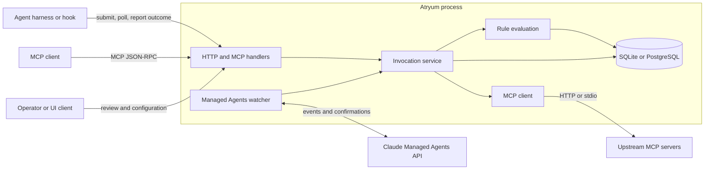
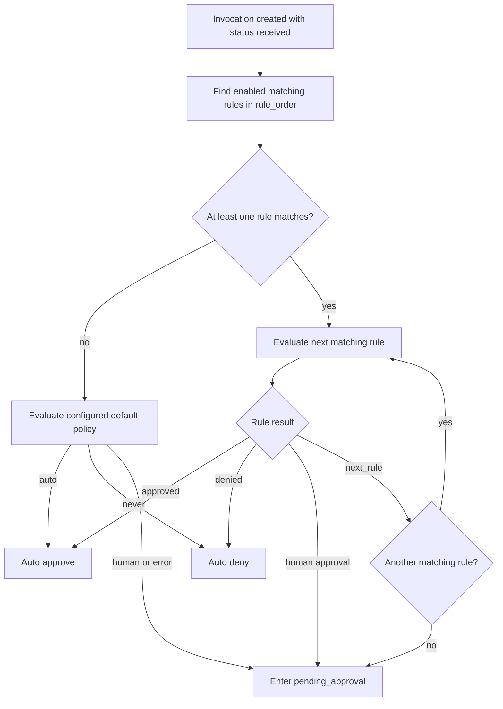
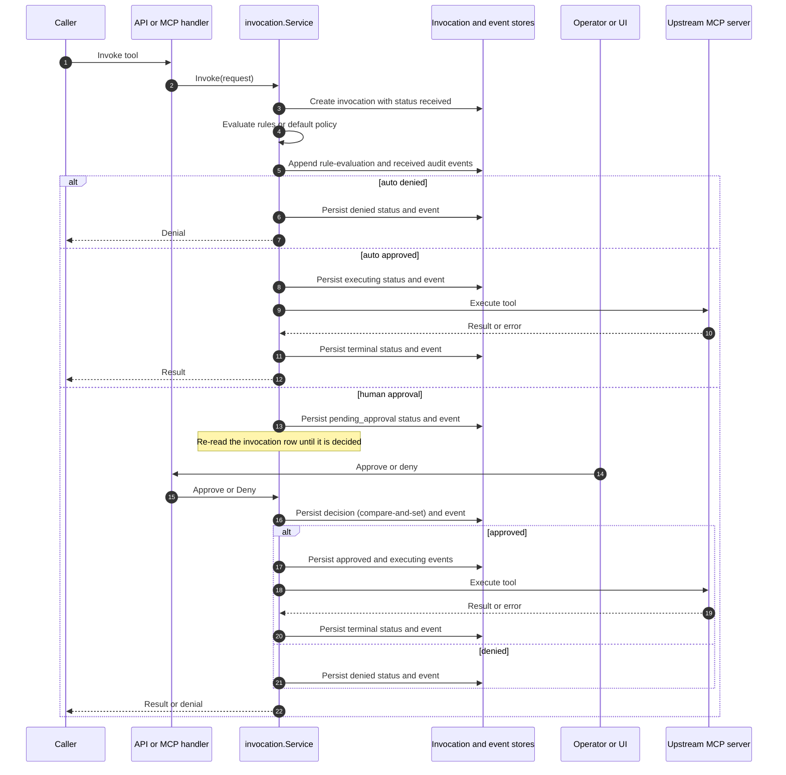
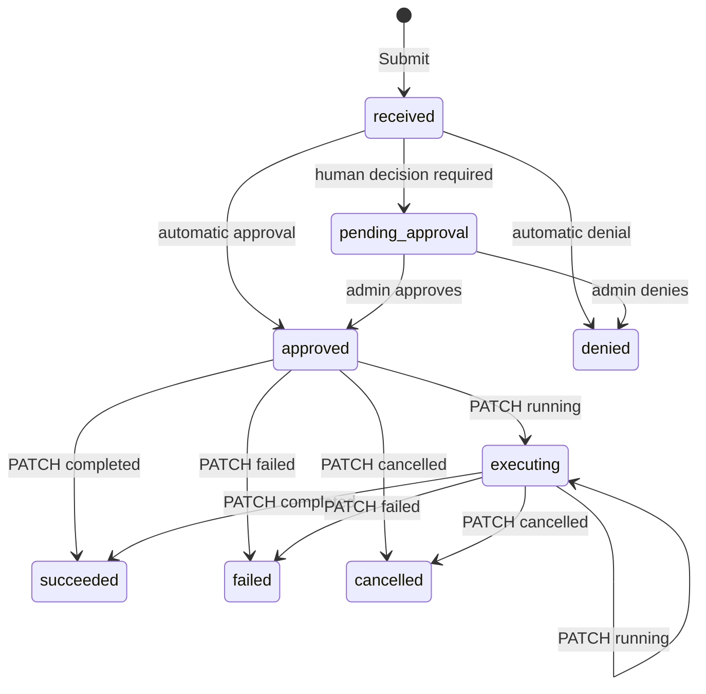
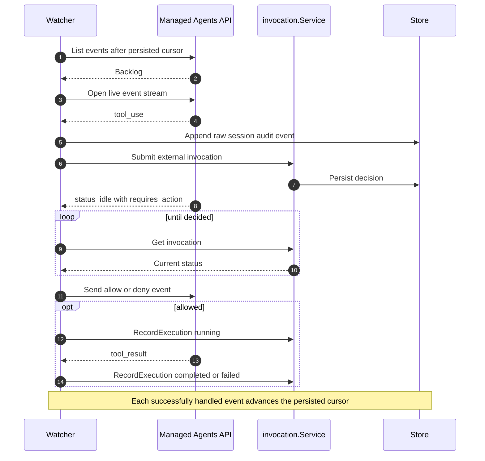

# Atryum architecture

This document describes Atryum's internal boundaries, control flow, and durable state.
For installation, configuration examples, endpoint details, and operator workflows, see
the [README](../README.md).

## System context

Atryum is a Go service that mediates tool calls. It exposes runtime endpoints to agent
harnesses, an MCP-compatible proxy, and review/operator APIs used by its UI. All ingress
paths share the same invocation service, rule evaluation, and audit store.

The diagram corresponds to `internal/api`, `internal/managedagents`,
`internal/invocation`, `internal/store`, and `internal/mcp`.

## Runtime ingress

The entry path determines who executes an approved tool. It does not change how rules
or audit records are evaluated.

| Path | Service operation | Executor | Completion source |
|---|---|---|---|
| Pre-tool hook: `POST /api/v1/external/invocations` | `Submit` | Calling harness | Harness reports through `PATCH /api/v1/external/invocations/{id}` |
| MCP proxy: `tools/call` on `/mcp/{server}` | `Invoke` | Atryum | Atryum records the upstream MCP result |
| Direct invocation: `POST /api/v1/invocations` | `Invoke` | Atryum | Atryum records the upstream MCP result |
| Managed Agents bridge | `Submit` and `RecordExecution` | Anthropic runtime | Watcher maps Anthropic events to invocation updates |

`Submit` intentionally leaves `upstream_name` empty because it makes a decision only.
`Invoke` resolves a configured MCP server before evaluating and executing the call.

Both operations accept an idempotency key (`idempotency_key` or the `Idempotency-Key`
header). Keys are unique per agent: the verified agent identity when auth is on, else
the `agent_id` a `Submit` caller declares, else one shared anonymous scope. A retry
with the same key and the same request (path, server, tool, and input compared as
JSON) returns the original invocation. The same key with a different request is
rejected with `409 Conflict` (`invocation.ErrIdempotencyConflict`) and reveals nothing
about the earlier call, and another agent's key never finds that agent's invocation.
Without verified identity, a key is only as private as the agent ID a caller claims.

## Component boundaries

| Package | Responsibility | Must not own |
|---|---|---|
| `internal/api` | HTTP/MCP transport, authentication middleware, request/response mapping, embedded UI | Rule or invocation state transitions |
| `internal/invocation` | Invocation lifecycle, rule matching, AI evaluation dispatch, approval coordination | SQL or upstream transport details |
| `internal/store` | SQLite/PostgreSQL repositories, schema migrations, durable query semantics | Policy decisions |
| `internal/mcp` | Server resolution, MCP forwarding, upstream authentication and OAuth | Approval policy |
| `internal/auth` | Inbound OIDC/JWT and API-key validation, authenticated identity and principal context | Upstream MCP credentials |
| `pkg/authz` | Human principal, actions, and the pluggable `Authorizer` seam (default: admin/member + agent membership) | Authentication |
| `internal/managedagents` | Anthropic session discovery, event replay, confirmation delivery | Independent rule evaluation |

The React application in `ui/` is compiled into `internal/api/web/` for the production
binary. During development it can run separately, but it still uses the same review and
operator APIs.

## Decision pipeline

Rules are loaded in ascending `rule_order`. Matching uses server/source, tool, and the
resolved local agent record. A local agent record is derived from the authenticated
runtime identity; on the no-auth external path, the submitted `agent_id` is used.

`next_rule` is produced only by `ai_evaluation`. If every matching AI rule defers,
Atryum falls back to human approval. The global policy provider is used only when no
rule matches; it is not evaluated after a matching rule defers.

An `ai_evaluation` rule selects one configured evaluator. Standalone deployments use
a local LLM configuration stored in `llm_configs`. Evaluation errors escalate to human
review; missing charter context denies; and an unknown verdict is treated as
`next_rule`, eventually reaching human review if no later rule decides.

## Atryum-executed calls

`Invoke` owns the complete execution lifecycle. A human-gated HTTP request stays
open until its invocation row leaves
`pending_approval` or the caller's request context is cancelled (a client
disconnect or a client-side timeout). Atryum imposes no approval deadline of its
own: the configured `request_timeout_seconds` bounds upstream tool execution, not
the human wait.

Because the row is the source of truth, an approval or denial recorded by any
process releases the held request. With PostgreSQL, the transaction that
records the decision sends `NOTIFY atryum_invocation_decided` with the
invocation ID, and each process keeps one connection on `LISTEN` to wake its
held request at once. The listening connection is pinged after ten quiet
seconds and reconnects after an error, re-checking every held request when it
does. As the fallback, a held request also re-reads its row every two seconds
while the listener is connected and every 250 ms otherwise; SQLite has no
notifications, so there it always re-reads every 250 ms. The listener needs a
session-mode connection: PgBouncer in transaction mode accepts `LISTEN` but
never delivers notifications, leaving held requests on the two-second poll;
set `server.database_listen = false` there to skip the listener and poll every
250 ms. Decisions and the move to `executing` are
compare-and-set on the row's status, so a call is decided once and run once.
What is not implemented:

- Caller cancellation marks a still-pending (or approved but not yet running)
  invocation failed. The stored error text says "cancelled", but the persisted
  status is `failed`.
- An abrupt process exit drops the held request. Nothing resumes it on another
  process, so a later approval updates the row but does not execute the tool.

The admin invocation stream is a polling SSE view: the handler queries the durable
invocation list every two seconds and emits when its signature changes. Database writes
do not directly publish to the stream.

## Decision-only calls

`Submit` persists and returns a decision without contacting an MCP server. An external
executor polls a pending invocation, runs the tool only after approval, and reports its
execution state.

The state diagram shows the supported caller contract, not enforced transitions.
`RecordExecution` currently validates only the transition to `running`; the terminal
reports (`completed`, `failed`, `cancelled`) are applied without checking the prior
status, so callers must not report a terminal outcome before approval. When inbound auth supplies an agent identity, the service also checks that
the invocation belongs to that agent. In no-auth mode, ownership cannot be verified.

## Managed Agents bridge

Each configured account can run watchers for linked Anthropic sessions. A watcher
replays events from its persisted cursor, follows the live SSE stream, and reconnects
after failures. Tool calls still use `Submit`, so this bridge does not introduce a
second policy engine.

Tool-use submission is idempotent across replay because the Anthropic event ID is used
as the invocation idempotency key. Cursor advancement waits until the event handler has
completed successfully enough to avoid skipping a confirmation that must be retried.

## Durable model

The core tables are:

| Table | Architectural role |
|---|---|
| `invocations` | Current state and request/result material for each governed call |
| `invocation_events` | Ordered event history for an invocation, written with each state change |
| `approval_rules` | Ordered match criteria and decision action |
| `agents` | Mapping from runtime identities to named governance records |
| `users` | Just-in-time cache of humans seen at the operator API, keyed by issuer and subject; role and disabled flag |
| `agent_members` | Which users may operate which agents (join table) |
| `api_keys` | Hashed first-party agent credentials with creator, expiry, revocation, and last-use |
| `mcp_servers` | Runtime upstream definitions and connection state |
| `oauth_credentials` and `oauth_connect_sessions` | Upstream OAuth credentials and browser-flow state |
| `llm_configs` | Local AI-evaluation providers |
| `managed_agent_bindings`, `managed_agent_sessions` | Anthropic agent/session ownership and replay state |
| `external_sessions` | Atryum-minted harness sessions linking external invocations for cross-call evaluation context |

Schema changes are ordered migrations under `internal/store/migrations/` and are
applied at startup for both SQLite and PostgreSQL.

An invocation's row is the authoritative record of current state. Every change
to it is written in one transaction with its `invocation_events` row, so state
and history cannot disagree; an embedding program's event hook
(`pkg/atryum.WithEventHook`) runs inside that same transaction.

## Embedding

`pkg/atryum` runs this server as a library. Besides extra routes, migrations and
the database handle, an embedding program can set:

- `WithDecider`: every call on every path is decided by the program (allow,
  notify, deny, or pending with a review ID). Rules, plans and the default policy
  are skipped, a decider error denies, and only agent-facing routes are mounted.
- `WithEventHook`: called with the transaction for every invocation change, so
  the program's own records commit or roll back with it. A change that cannot
  be recorded before a tool runs stops the call (it is denied); once the tool
  has run, its outcome is recorded even if the caller has gone, and a failure
  to record it is logged rather than returned, so the agent is not invited to
  retry a call that already ran.
- `WithRequireAgentAuth`: refuse to start without an enabled `[[auth]]` issuer
  or with `skip_verify`, and reject agent requests without a verified identity.
  Agent API keys do not count as that issuer.
- `WithAgentAPIKeys`: accept `atr_` agent API keys on the agent routes. On by
  default, off by default under `WithDecider` (the program keeps its own agent
  registry); when off, an `atr_` bearer gets 401. The decider and event hook see
  how each caller authenticated (`ToolCall.Auth`, `Invocation.Auth`).
- `WithDatabaseURL`: the database URL, overriding the config file.

## Path arguments

A rule decides from the text of a call; the file is opened by an upstream MCP
server, often on another machine. `pkg/policy` cleans a path's spelling before
matching (case, escapes, file URLs, `//`, `..`, and Windows prefixes, drives,
trailing dots and streams), but text alone cannot say where a Windows short name
(`PROGRA~1`), a share (`\\host\C$`), a variable (`%SystemRoot%`, `$HOME`), a
relative path or a link leads. Three layers cover that, each catching what the
one before cannot:

| Layer | Owner | Catches |
| --- | --- | --- |
| Allow rules on paths, everything else to a person | Rule author | Any spelling the allow rule doesn't name, including `..` out of the folder |
| A firm rule on `facts.ambiguous_path`, set from `policy.AmbiguousPath` | Embedder | Short names, shares, devices, variables, `~`, drive-relative and climbing relative paths, `/proc` links, even inside an allowed folder |
| Confinement in the upstream server | Operator | Symlinks, junctions, hard links and mounts |

Deployment requirements for upstream servers whose tools take paths or run
commands:

- **Check the real path.** Resolve it after opening (`realpath`, or `openat2`
  with `RESOLVE_BENEATH`, on Linux; `GetFinalPathNameByHandle` on Windows) and
  refuse anything outside the server's configured roots. A check on the text
  before opening is not enough: a link swapped in between check and open wins.
- **Run with least privilege.** A container or VM with only the workspace
  mounted, or a dedicated account (an AppContainer or restricted ACLs on
  Windows) that cannot read what a policy miss would expose.
- **Don't rule on shell text.** `cat $(echo L2V0Yy9wYXNzd2Q= | base64 -d)`
  names no path a rule can see. Route shell tools to a judge or a person, or
  allow only specific commands with a `command` condition: it matches a line
  only when every command in it is one of its patterns, and matches nothing it
  can't read (an expansion like this one, a shell other than bash or zsh). It
  is for allowing; to deny or hold, `contains` and `prefix` match more.

## Configuration and ownership

`atryum.toml` owns process bootstrap concerns: listening, database selection, inbound
auth, optional external service credentials, default policy, and initial upstreams.
After the first successful bootstrap, MCP server definitions, rules, agents, evaluator
settings, and connection state are database-owned and managed through the operator APIs.

This separation prevents runtime changes from being overwritten by a restart. In
particular, `[[upstreams]]` seeds an empty `mcp_servers` table; it is not continuous
configuration reconciliation.

## Authentication boundaries

Inbound and upstream authentication are separate trust boundaries:

- Agent runtime auth accepts two bearer shapes. A token starting with `atr_` is an
  Atryum API key: it is hashed and resolved against `api_keys` (joined to the creator's
  `users.disabled_at`), and identifies the agent as the `agents.id` the key points at.
  Any other bearer is an IdP JWT whose configured agent identity claim is used. Either
  way the invocation service receives the same trusted identity for rule targeting and
  ownership checks, and records the issuer, method (`jwt`, `api_key`, or `no_auth` for a
  self-declared agent ID; `managed_agent` for the Managed Agents bridge) and key id on
  the invocation. Keys also work with no IdP
  configured; presenting one opts the request into key authentication. An embedder can
  turn keys off (`WithAgentAPIKeys(false)`, the default under `WithDecider`).
- Operator API auth authenticates any user from an `admin_enabled = true` provider,
  provisions a `users` row on first sight, and attaches an `authz.Principal` (admin when
  the configured admin claim is present, member otherwise). Authorization is decided per
  route through `authz.Authorizer`: legacy operator routes require admin; agents, their
  keys and members are authorized by membership. Disabling a user revokes the keys they
  issued; removing a member revokes their keys on that agent.
- The open core owns authentication and this minimal identity model. Embedding programs
  layer richer roles and groups on top by replacing the `Authorizer`
  (`pkg/atryum.WithAuthorizer`), mounting routes behind the operator auth chain
  (`WithAuthenticatedRoutes`), and adding namespaced migrations that reference
  `users.id`; the open core never references extension tables.
- Upstream MCP authentication is owned by `internal/mcp/auth_provider`; credentials and
  OAuth tokens are never returned to the agent caller.
- No-auth mode is a local deployment option. Identity supplied by a caller in this mode
  is attribution, not a cryptographic ownership guarantee.
